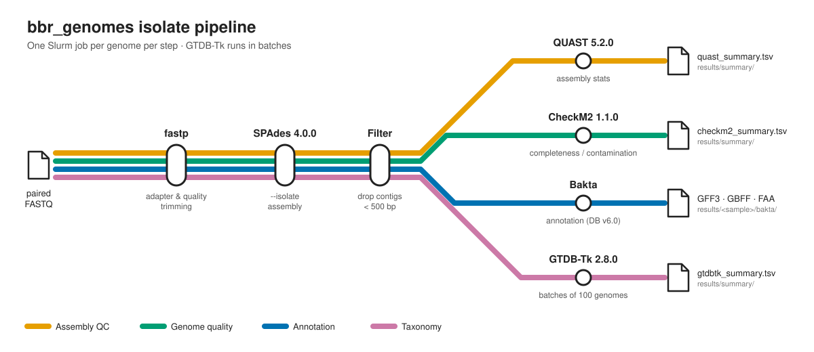

<p align="right">
  <a href="https://agmicrobiomebase.org/">
    <picture>
      <source media="(prefers-color-scheme: dark)" srcset="docs/images/cryobank_logo_dark.png">
      
    </picture>
  </a>
</p>

# bbr_genomes: bacterial isolate genome pipeline

[](https://zenodo.org/badge/latestdoi/1464297303)
[](https://www.nextflow.io/)
[](https://creativecommons.org/licenses/by/4.0/)

A Nextflow pipeline that turns Illumina paired-end reads from bacterial isolates into
quality-checked, annotated and taxonomically classified genomes. It is built for hundreds of
isolates at once: each step for each genome runs as its own job, and one bad genome does not
stop the others.



| Step | Tool | Output |
|---|---|---|
| Read trimming | [fastp](https://github.com/OpenGene/fastp) 1.4.0 | adapter/quality-trimmed reads, QC report |
| Assembly | [SPAdes](https://github.com/ablab/spades) 4.0.0 (`--isolate`) | contigs; those < 500 bp are dropped |
| Assembly statistics | [QUAST](https://github.com/ablab/quast) 5.2.0 | N50, size, contig counts |
| Completeness / contamination | [CheckM2](https://github.com/chklovski/CheckM2) 1.1.0 | genome quality |
| Annotation | [Bakta](https://github.com/oschwengers/bakta) 1.12.2 | GFF3, GenBank, proteins, AMR/VF hits |
| Taxonomy | [GTDB-Tk](https://github.com/Ecogenomics/GTDBTk) 2.8.0 | GTDB classification (run in batches) |

The pipeline was written to process the bacterial isolates of the
[UK Crop Microbiome Cryobank](https://agmicrobiomebase.org/) (see
[About the isolates](#about-the-isolates)). It works on any set of bacterial isolates
sequenced with Illumina paired-end reads.

## Quick start

You need [Nextflow](https://www.nextflow.io/) ≥ 25.10 and one of Docker, Singularity,
Apptainer or conda, plus the three reference databases (see [Databases](#databases)).

```bash
nextflow run main.nf \
    -profile apptainer,slurm \
    --samplesheet samplesheet.tsv \
    --outdir results \
    --bakta_db   /path/to/bakta/db \
    --checkm2_db /path/to/CheckM2_database/uniref100.KO.1.dmnd \
    --gtdbtk_db  /path/to/gtdbtk/release232 \
    -resume
```

Running the same command again with `-resume` continues an interrupted run; finished steps
are not repeated.

### Profiles

| Profile | Use |
|---|---|
| `docker`, `singularity`, `apptainer` | run every tool in its [BioContainers](https://biocontainers.pro/) image |
| `conda` | install every tool from Bioconda |
| `slurm` | submit each step as a Slurm job (`--slurm_partition`, `--queue_size`) |
| `test` | 3 small simulated genomes in `test/`; combine with a software profile |

Without `slurm`, everything runs on the local machine. Default resource requests are sized
for a 31-CPU / 350 GB node (SPAdes 15 CPUs / 64 GB; GTDB-Tk 31 CPUs / 160 GB). On a smaller
machine, cap them with a config file passed with `-c`:

```groovy
process.resourceLimits = [cpus: 16, memory: 128.GB, time: 48.h]
```

The same file is the place for site settings such as a cluster account, extra
`clusterOptions`, or the database paths so they need not be given on the command line.

## Input

A tab-separated samplesheet with three columns. The header line is optional. Read paths can be
absolute, or relative to the samplesheet's folder.

```
sample_name	read1	read2
isolate_001	/data/reads/isolate_001_R1.fastq.gz	/data/reads/isolate_001_R2.fastq.gz
isolate_002	reads/isolate_002_R1.fastq.gz	reads/isolate_002_R2.fastq.gz
```

Sample names may contain only letters, digits, `.`, `_` and `-`. Before submitting anything,
the pipeline checks every name, every read file and the databases, and lists all problems at
once.

## Databases

| Parameter | Database | How to get it |
|---|---|---|
| `--bakta_db` | Bakta DB, full (~70 GB) or light | `bakta_db download --output <dir> --type full` |
| `--checkm2_db` | CheckM2 DIAMOND DB (`uniref100.KO.1.dmnd`) | `checkm2 database --download --path <dir>` |
| `--gtdbtk_db` | GTDB-Tk reference data, release 232 (~110 GB) | `download-db.sh` from GTDB-Tk, or the [GTDB data site](https://data.gtdb.ecogenomic.org/releases/) |

The Cryobank genomes were processed with Bakta DB v6.0 (2025-02-24) and GTDB release 232.

## Output

```
results/
  <sample>/fastp/     trimmed reads, fastp json/html/log
  <sample>/spades/    <sample>.fasta (contigs >= 500 bp, used downstream), raw contigs/scaffolds, graph, log
  <sample>/quast/
  <sample>/checkm2/
  <sample>/bakta/
  <sample>/gtdbtk/    <sample>.gtdbtk.summary.tsv
  gtdbtk_batches/     full GTDB-Tk output per batch (trees, alignments, logs)
  summary/            quast_summary.tsv, checkm2_summary.tsv, gtdbtk_summary.tsv (all genomes)
  pipeline_info/      trace.txt, report.html, timeline.html
```

### Progress report

For a run with hundreds of genomes, `bin/pipeline_progress.sh` shows how far each step has
got. Run it at any time, during or after the run:

```bash
bash bin/pipeline_progress.sh samplesheet.tsv results
```

It writes `results/progress.txt` (% of genomes done / failed / pending per step) and
`results/progress_per_sample.tsv` (one row per genome).

## Parameters

| Parameter | Default | |
|---|---|---|
| `--samplesheet` | required | TSV as above |
| `--outdir` | `results` | |
| `--bakta_db`, `--checkm2_db`, `--gtdbtk_db` | required | see [Databases](#databases) |
| `--min_contig_len` | 500 | contigs shorter than this are removed after assembly |
| `--spades_mode` | `--isolate` | |
| `--save_trimmed_reads` | true | copy trimmed reads into each genome folder |
| `--gtdbtk_batch_size` | 100 | genomes per GTDB-Tk job; batches run in parallel |
| `--gtdbtk_pplacer_cpus` | 8 | |
| `--gtdbtk_full_tree` | false | use the full GTDB tree (~1.5 TB RAM; sent to `--largemem_partition`) |
| `--slurm_partition`, `--largemem_partition` | cluster default | |
| `--queue_size` | 20 | max Slurm jobs at once (pending + running) |

## Failures

A step killed for memory or time is retried up to twice with more resources. If it still
fails, that genome is skipped for the remaining steps and the rest carry on. Failed genomes
are marked `FAILED` in `progress_per_sample.tsv`; the work folder with `.command.err` is
listed in `pipeline_info/trace.txt`.

## Test data

`test/reads/` holds reads simulated by `test/simulate_reads.py` (150 bp PE, ~40x, 0.2 %
errors, adapters on short inserts) from two small genomes:

| sample | genome | expected |
|---|---|---|
| test_buchnera   | *Buchnera aphidicola* APS, NC_002528.1, 0.64 Mb | full run, GTDB: s__Buchnera aphidicola |
| test_rickettsia | *Rickettsia prowazekii* Madrid E, NC_000963.1, 1.1 Mb | full run, GTDB: s__Rickettsia prowazekii |
| test_lowreads   | 300 read pairs of Buchnera | fails at SPAdes; checks that one bad genome doesn't stop the run |

```bash
nextflow run main.nf -profile test,docker --bakta_db ... --checkm2_db ... --gtdbtk_db ...
```

## About the isolates

The pipeline was developed for genomes of isolates from the
**[UK Crop Microbiome Cryobank](https://agmicrobiomebase.org/)**, catalogued in
**[AgMicrobiomeBase](https://agmicrobiomebase.org/data)**. The Cryobank holds bacterial
isolates from the rhizospheres of six UK crops (wheat, barley, oats, oilseed rape, faba bean
and sugar beet) grown in nine agricultural soils, cryopreserved together with their soil
metadata. The resource is described in
[*Introducing the UK Crop Microbiome Cryobank data resource, AgMicrobiomeBase, with case
studies and methods on metabarcoding analyses*](https://pmc.ncbi.nlm.nih.gov/articles/PMC12372229/).

The UK Crop Microbiome Cryobank is a partnership between
[Rothamsted Research](https://www.rothamsted.ac.uk/),
the [John Innes Centre](https://www.jic.ac.uk/),
[CABI](https://www.cabi.org/),
[SRUC](https://www.sruc.ac.uk/) and
the [James Hutton Institute](https://www.hutton.ac.uk/).

## Citations

If you use this pipeline, please cite it using the DOI above, together with the tools it runs:

- **fastp**: Chen S. (2023) Ultrafast one-pass FASTQ data preprocessing, quality control, and deduplication using fastp. *iMeta* 2:e107.
- **SPAdes**: Prjibelski A. et al. (2020) Using SPAdes de novo assembler. *Curr Protoc Bioinformatics* 70:e102.
- **QUAST**: Gurevich A. et al. (2013) QUAST: quality assessment tool for genome assemblies. *Bioinformatics* 29:1072–1075.
- **CheckM2**: Chklovski A. et al. (2023) CheckM2: a rapid, scalable and accurate tool for assessing microbial genome quality using machine learning. *Nat Methods* 20:1203–1212.
- **Bakta**: Schwengers O. et al. (2021) Bakta: rapid and standardized annotation of bacterial genomes via alignment-free sequence identification. *Microb Genom* 7:000685.
- **GTDB-Tk**: Chaumeil P.-A. et al. (2022) GTDB-Tk v2: memory friendly classification with the Genome Taxonomy Database. *Bioinformatics* 38:5315–5316.
- **Nextflow**: Di Tommaso P. et al. (2017) Nextflow enables reproducible computational workflows. *Nat Biotechnol* 35:316–319.

## Authors

[Rodrigo G Taketani](https://orcid.org/0000-0002-5999-8704),
[Ian M Clark](https://orcid.org/0000-0002-1589-5420),
[Catriona M A Thompson](https://orcid.org/0000-0002-0069-2727),
[J Miguel Bonnin](https://orcid.org/0000-0002-5095-6719),
Helen Stewart,
[Jacob G Malone](https://orcid.org/0000-0003-1959-6820),
[Susan Jones](https://orcid.org/0000-0002-1560-9009),
[Nicola Holden](https://orcid.org/0000-0002-7904-4529),
[Mathew J Ryan](https://orcid.org/0000-0002-3689-6609),
[Timothy H Mauchline](https://orcid.org/0000-0002-8590-2614)

## Funding

The UK Crop Microbiome Cryobank project was funded by the BBSRC BBR resource under the project
numbers: BB/T019492/1, BB/T019484/1, BB/T019700/1 and BB/T019808/1.

## License

This repository is licensed under the Creative Commons Attribution 4.0 International License (CC BY 4.0).
See the [LICENSE](./LICENSE.txt) file for details.

[](https://zenodo.org/badge/latestdoi/1464297303)
